  

Hi, I'm Kartikeya. I study cognitive science (machine learning track) with a CS minor at UC San Diego, class of 2028.

My CS, data science, and ML courses are my favorites, and studying how minds perceive and learn shapes how I build models. It's also made me extremely quick and strategic about picking up new skills.

I like building AI systems end to end: the model, the software around it, and getting it working for the people who use it.

This GitHub is newer. More is on the way as I build and transfer.

## Things I've built

- **[unet-inference-client](https://github.com/21Kart28/unet-inference-client)**: Desktop app that runs CT segmentation models from one window, replacing a manual chain of terminal commands and shell scripts. It cut a model run from about 25 minutes to under 2, and a 24-person research team at Baylor College of Medicine / Texas Children's Hospital now uses it. Run one scan or a whole dataset, score results against ground truth, and compare two models case by case. Python, PySide6/Qt, MONAI Label.

- **[depth-map](https://github.com/21Kart28/depth-map)**: Reflective journaling tool. It asks one open question at a time, has an LLM analyze the answer, and retrieves related past entries by embedding similarity, with a hand-labeled eval to measure retrieval quality. Next: a map of recurring themes linked to the entries they came from. FastAPI, SQLite, Claude API.

- **Pediatric prosthetic hand**: 3D-printed, child-sized hand where a MobileNet picks the grip on $50 of microcontrollers. I lead the student R&D team. Private for now.

When I'm not building:

  

Want a hackathon teammate, or have a team I should join? Reach out :)
