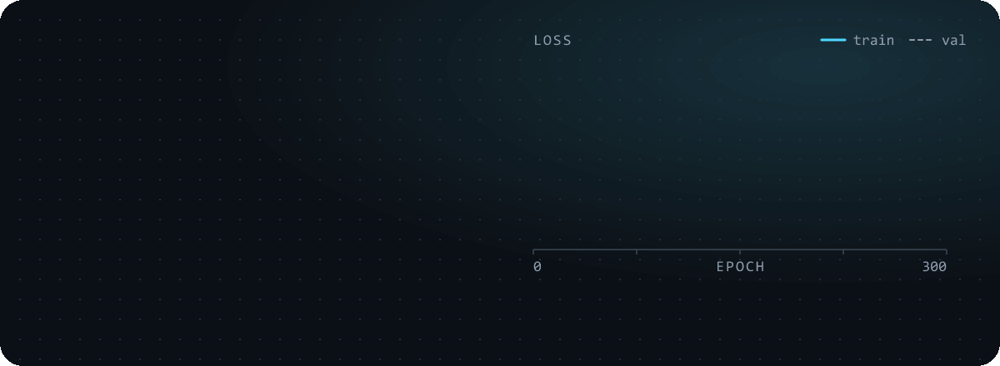

  

Hi, I'm Kartikeya. Cognitive science (ML track) and a CS minor at UC San Diego, class of 2028.

This past summer I trained a 3D U-Net to segment aortas in CT scans at Texas Children's / Baylor. Dice went from 0.64 to 0.90. The patients were mice. Now I lead a four-student team at Baylor building a 3D-printed prosthetic hand sized for a seven-year-old. The last three teams built the same hand with three different brains. Ours is $50 of microcontrollers and a MobileNet.

This account is three months old, so the shelves are a little bare.

## Things I've built

- **Pediatric prosthetic hand** — a palm camera picks the grip, forearm EMG opens and closes it, and voice only switches modes; firmware caps the pinch at 10 N. Private for now.
- **[unet-inference-client](https://github.com/21Kart28/unet-inference-client)** — Qt app that runs MONAI Label 3D segmentation on CT scans, scores Dice and HD95, and opens the result in 3D Slicer with smoothing off so you see the real voxels. It replaced chaining shell scripts by hand for every scan.
- **[depth-map](https://github.com/21Kart28/depth-map)** — CLI that asks one open question at a time and analyzes the answer. Its README says "Map, which isn't built yet," so yes, it's named after the half that doesn't exist.

Off the keyboard: cross-country in high school (5K in 18:58), Eagle Scout, and more Fusion 360 than I planned on.
