  

Hi, I'm Kartikeya. Cognitive science (ML track) plus a CS minor at UC San Diego, class of 2028. Studying intelligence, perception, and learning doesn't only inform how I make my builds and systems smarter, it helps me pick up skills and knowledge faster!

I like owning the whole ML stack: label the data, train the model, then build the tool people actually use.

This GitHub is new, so I'm still moving my projects over. More is on the way.

## Things I've built

- **[unet-inference-client](https://github.com/21Kart28/unet-inference-client)** — Desktop app I built during my ML research internship at Baylor College of Medicine / Texas Children's Hospital. Running a segmentation model there used to mean activating an environment, starting a server from the terminal, and chaining shell scripts by hand for every scan. Now it's a window: run one CT scan or batch a whole dataset, score every result against ground truth (Dice, volume, HD95), line two models up case by case, and open any prediction in 3D Slicer with smoothing off so you see the real voxels. Python, PySide6/Qt, MONAI Label.
- **[depth-map](https://github.com/21Kart28/depth-map)** — A reflective-questioning tool in two halves. Depth asks one specific, open question at a time and has an LLM analyze your answer. Map will track the themes that keep coming back and link each one to the entries it came from. Map isn't built yet, so for now it's named after the half that doesn't exist. No API key? It still runs offline on a fake provider.
- **Pediatric prosthetic hand** — 3D-printed and child-sized; a MobileNet picks the grip on $50 of microcontrollers. I lead the R&D. Private for now.

When I'm not building, learning, and researching, you'll find me surfing, fishing, cliff jumping, and having philosophical debates with my friends.
Reach out if you want to do hackathons together or join a team :)
